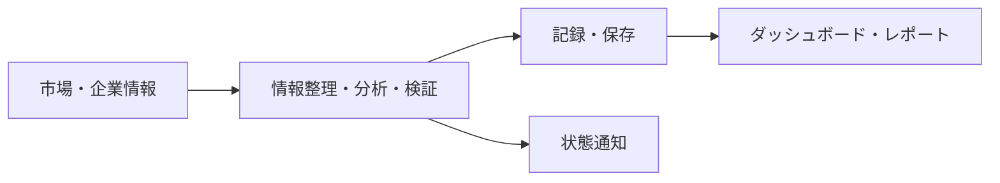

# システム概要

## 目的

資産の管理と運用の支援・自動化を目的に開発しているアプリケーションです。市場情報・資産の状態・分析結果・運用記録を一か所で確認し、分析や検証の経緯を把握できるようにしています。画面の表示だけでなく、情報の整理、定期処理、仮想取引による検証、レポート作成を扱います。

自動化には情報取得・整理・定期処理・記録を含みます。実資金による自動売買の完成・稼働を示すものではありません。

## 全体の役割

図は責務を説明するための概略です。内部の呼び出し順序、判断条件、接続先、データ構造を表すものではありません。

| 領域 | 役割 |
| --- | --- |
| Frontend | 資産情報、分析結果、監視情報、レポート、タイムラインの表示 |
| Backend | API、データ検証、処理の取りまとめ、共通機能 |
| 定期処理 | 時間に基づく情報取得・更新・記録 |
| データ基盤 | 業務データ・時系列データ・長期保存の管理 |
| AI 支援 | Google Gemini / OpenAI GPT による情報整理、定性的な分析、説明・レポートの補助 |
| 運用確認 | 状態通知、実行・抑止の記録、コストの確認 |

## 投資分析の区分

| 区分 | 説明する範囲 |
| --- | --- |
| 短期 | 短い時間軸を対象にした分析・検証の区分 |
| 長期 | より長い時間軸を対象にした分析・検証の区分 |
| シーン別 | 市場の状況に応じて検討対象を分ける区分 |

区分の存在を説明するもので、具体的な手法・対象銘柄・判断条件・配分・切り替え条件は含みません。利用する指標の組み合わせや詳細な状態遷移も掲載していません。

## 銀行機能の境界

2026-10-12 時点で銀行口座とは接続していません。銀行関連の連携は、残高照会などの閲覧に限定する設計です。銀行口座からの送金・出金を実行する機能は提供しません。

この説明は銀行機能についてのものです。システム全体が閲覧だけを行うという意味ではなく、情報の保存や分析、仮想取引による検証も扱います。

## このリポジトリで確認できること

元システムの概要・採用技術・確認できた設計理由に加え、実コードから抽出した設定値アクセサと表示部品を確認できます。アプリ本体の起動や投資判断の再現はできません。コードの由来と加工内容は [CODE_SCOPE.md](CODE_SCOPE.md) に記載しています。
